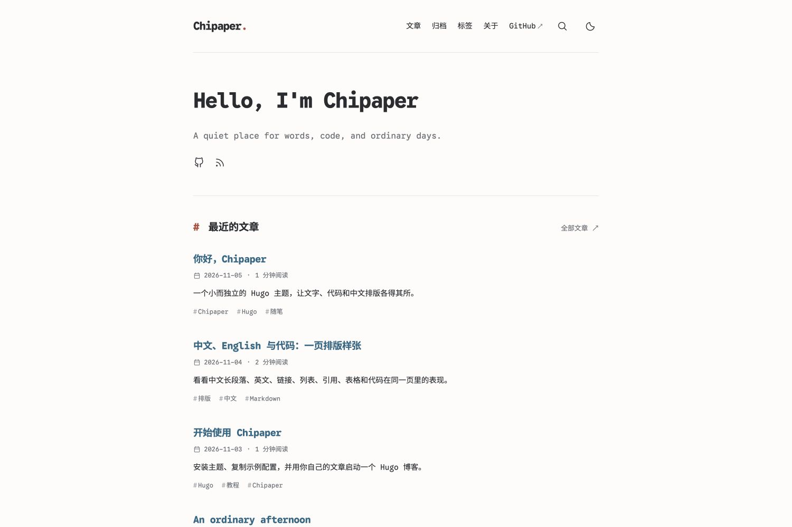

# Chipaper

A small, independent, Chinese-first Hugo blog theme inspired by
[AstroPaper](https://github.com/satnaing/astro-paper) and
[Archie](https://github.com/athul/archie).

[Live demo](https://chius-me.github.io/chipaper/) · [Chius's blog](https://chius.cc/) · [中文文档](https://github.com/chius-me/chipaper/blob/main/README.md)



Chipaper pairs **Google Sans Code** with **Sarasa Mono SC** for Latin text,
Chinese, and code. Fonts are self-hosted and split by Unicode range. It offers
light/dark modes, article lists, archives, tags, substring full-text search,
collapsible TOC, heading anchors, code copying, RSS, sitemap, and optional
Giscus comments. The UI labels currently use Chinese; mixed-language articles
are supported. Search is literal substring matching, without fuzzy ranking.

## Try the demo locally

Hugo **0.158.0+** is required. The demo is built with Extended **0.161.1**.
Ordinary builds require no Node.js, npm, or Python.

```sh
git clone https://github.com/chius-me/chipaper.git
cd chipaper
hugo server --source exampleSite --baseURL http://localhost:1315/ --port 1315
```

## Install

From an existing Git-initialized Hugo site:

```sh
git submodule add https://github.com/chius-me/chipaper.git themes/chipaper
```

Set `theme = "chipaper"`, enable `hasCJKLanguage`, include `JSON` in home
outputs, and set `markup.highlight.noClasses = false`. See the complete
[example config](https://github.com/chius-me/chipaper/blob/main/exampleSite/hugo.toml). Its `themesDir = "../.."` is only
for running the repository demo; omit that option in an ordinary blog.

Posts live in `content/posts/`. Copy the archive, search, about, posts index,
and tags index pages from [`exampleSite/content`](https://github.com/chius-me/chipaper/tree/main/exampleSite/content/).
Article front matter supports standard Hugo fields and `description` for the
home excerpt. Per-post `showComments: false` disables comments.

```toml
[params.author]
  name = "Your Name"

[params.chipaper]
  greeting = "Hello, I'm Your Name"
  motto = "Write about the things you care about."
  recentCount = 7
  showRSS = true
  showTags = true
  comments = false

[[params.social]]
  name = "GitHub"
  icon = "github"
  url = "https://github.com/your-name"
```

Social icons support `github`, `mail`, and `rss`; other names use a generic
link icon. Internal navigation should use Hugo `pageRef`, which also works
under GitHub Pages project subpaths. Add site-specific styles to
`assets/css/custom.css` or override Hugo templates from your site.

For Giscus, enable `params.chipaper.comments` and fill `repo`, `repoid`,
`category`, `categoryid`, `mapping`, and `lang` under
`params.chipaper.giscus`. Keep article paths and Giscus mapping unchanged
when migrating an existing blog.

## Fonts

Latin text uses Google Sans Code; CJK glyphs use Sarasa Mono SC. Their native
advances are preserved, rather than enforcing an exact 2:1 character grid.
Italic text uses a synthetic browser slant in this version. All WOFF2 slices
total about 12 MiB; the two common CJK subsets total about 1 MiB. Remaining
glyphs load on demand and system fonts provide fallback.

Regeneration is optional and isolated with uv:

```sh
uv run scripts/build-fonts.py
```

The script pins the Sarasa version and does not install system fonts. Normal
Hugo builds consume the committed font files directly.

## Demo deployment and updates

The [Pages workflow](https://github.com/chius-me/chipaper/blob/main/.github/workflows/pages.yml) builds the example site on
push/PR and deploys `main` pushes to GitHub Pages. Enable **GitHub Actions**
as the Pages source in a fork's repository settings. The workflow gets the
actual base URL from Pages and supports project subpaths.

Update an installed theme with `git submodule update --remote themes/chipaper`,
preview locally, then commit the new submodule pointer in your blog.

## Credits and license

Chipaper implements its own Hugo templates and browser interactions while
drawing visual inspiration from AstroPaper and Archie. Its focus is mixed
Chinese/Latin typography, self-hosted Unicode font slices, and a Hugo build
without a Node pipeline.

Theme code is [MIT](https://github.com/chius-me/chipaper/blob/main/LICENSE); fonts retain their SIL Open Font Licenses.
See [third-party notices](https://github.com/chius-me/chipaper/blob/main/THIRD_PARTY_NOTICES.md) for upstream projects,
source references, and complete license files.

## Optional tags and archives

Set `params.chipaper.showTags = false` to hide article tags and exclude tags
from the search index. Set root-level `disableKinds = ["taxonomy", "term"]`
to stop generating taxonomy pages, then remove the archive/tag menu entries
and corresponding content pages. The theme and demo retain both features.
Search falls back to the article list when JavaScript is disabled.

The theme uses Hugo `mainSections` and supports sections named `post`,
`posts`, or other names. Set root-level `mainSections` to override automatic
section detection.
