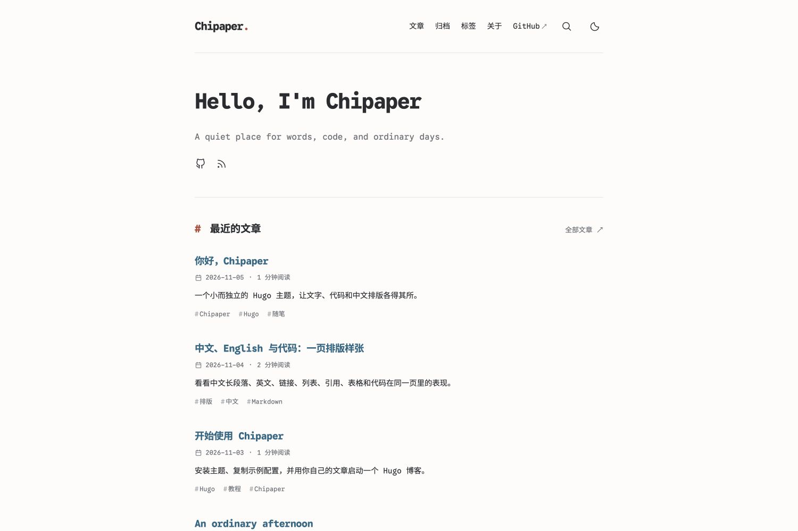

# Chipaper

我给自己博客用的 Hugo 主题。单栏，等宽字，中文和英文写在一起。样子参考了 [AstroPaper](https://github.com/satnaing/astro-paper) 和 [Archie](https://github.com/athul/archie)。

[在线 Demo](https://chius-me.github.io/chipaper/) · [我的博客](https://chius.cc/) · [English](https://github.com/chius-me/chipaper/blob/main/README.en.md)



正文用 **Google Sans Code** 和 **更纱等宽黑体（Sarasa Mono SC）**。字体文件放在主题里，按 Unicode 分段加载。浅色和深色跟着系统走，手动切换过会记住。

文章列表、归档、标签、搜索、可折叠目录、标题锚点、代码高亮和复制、RSS、sitemap 都有。界面文字是中文。搜索按字符串匹配：空格隔开的几个词要同时出现，中文可以直接搜。

Hugo **0.158.0** 以上就能构建。这个仓库的 Demo 用 Extended **0.161.1**。

## 本地看一眼

```sh
git clone https://github.com/chius-me/chipaper.git
cd chipaper
hugo server --source exampleSite --baseURL http://localhost:1315/ --port 1315
```

打开 <http://localhost:1315/>。示例文章在 `exampleSite/content/`。

## 装到自己的博客

博客已经是 Git 仓库的话，在根目录执行：

```sh
git submodule add https://github.com/chius-me/chipaper.git themes/chipaper
```

`hugo.toml` 可以先写成这样：

```toml
baseURL = "https://example.com/"
title = "My Blog"
theme = "chipaper"
locale = "zh-CN"
defaultContentLanguage = "zh"
hasCJKLanguage = true
enableRobotsTXT = true

[languages.zh]
  locale = "zh-CN"

[taxonomies]
  tag = "tags"

[outputs]
  home = ["HTML", "RSS", "JSON"]

[markup.highlight]
  noClasses = false

[params]
  description = "我的个人博客"

[params.author]
  name = "阿某"

[params.chipaper]
  greeting = "你好，我是阿某"
  motto = "平时写的东西放这儿。"
  recentCount = 7
  comments = false
  showRSS = true

[[params.social]]
  name = "GitHub"
  icon = "github"
  url = "https://github.com/your-name"

[[menus.main]]
  name = "文章"
  pageRef = "posts"
  weight = 10
[[menus.main]]
  name = "归档"
  pageRef = "archives"
  weight = 20
[[menus.main]]
  name = "标签"
  pageRef = "tags"
  weight = 30
[[menus.main]]
  name = "关于"
  pageRef = "about"
  weight = 40
```

完整例子在 [`exampleSite/hugo.toml`](https://github.com/chius-me/chipaper/blob/main/exampleSite/hugo.toml)。里面的 `themesDir = "../.."` 只为了在本仓库里跑 Demo，自己的博客删掉这一行。

这几个页面从 [`exampleSite/content/`](https://github.com/chius-me/chipaper/tree/main/exampleSite/content/) 抄一份再改：

| 路径 | front matter |
| --- | --- |
| `content/posts/_index.md` | `title: 文章` |
| `content/tags/_index.md` | `title: 标签` |
| `content/archives.md` | `title: 归档`，`layout: archives` |
| `content/search.md` | `title: 搜索`，`layout: search` |
| `content/about.md` | `title: 关于` |

搜索可以不放进菜单，导航上的放大镜会链到它。首页输出里要有 JSON，不然没有索引。

图标放在站点的 `static/`：`favicon.svg`，需要的话再加 `apple-touch-icon.png`。Demo 里带了一份 SVG。

## 写文章

默认放在 `content/posts/`：

```yaml
---
title: "今天又折腾了点什么"
date: 2026-11-05T12:00:00+08:00
description: "首页和搜索结果里的那行摘要。"
tags: ["日常", "开发"]
draft: false
---
```

没写 `description` 时，首页用正文第一段。`##` 和 `###` 会收进目录，可以折叠。地址、日期和草稿沿用你原来的 Hugo 设置。

单篇不想要评论，写 `showComments: false`。代码高亮要配 `markup.highlight.noClasses = false`，浅色和深色才能各用各的配色。

```sh
hugo server --disableFastRender
hugo --minify
```

## 配置

| 配置 | 说明 |
| --- | --- |
| `params.author.name` | 页脚上的名字。不填就用站点标题 |
| `params.chipaper.greeting` | 首页大标题。不填就用站点标题 |
| `params.chipaper.motto` | 标题下面那句。旧的 `params.author.headline` 也认 |
| `params.chipaper.recentCount` | 首页放几篇，默认 7 |
| `params.chipaper.showRSS` | RSS 图标，默认显示 |
| `params.chipaper.showTags` | 文章上的标签，以及搜索里带不带标签。默认带 |
| `params.chipaper.comments` | Giscus，默认关 |
| `params.defaultSocialImage` | 分享图。可以是 `assets/` 里的文件，也可以是站内路径或完整网址 |
| `params.social` | 社交链接，每项有 `name`、`icon`、`url` |

文章栏目看 Hugo 的 `mainSections`。你不写的话，Hugo 选文章最多的那个栏目。要指定就在配置最外层写 `mainSections = ["posts"]`。目录叫 `post` 或 `notes` 也行。

### 关掉标签和归档

```toml
disableKinds = ["taxonomy", "term"]

[params.chipaper]
  showTags = false
```

再从菜单里去掉「标签」和「归档」，删掉 `content/tags/_index.md` 和 `content/archives.md`。浏览器没开 JavaScript 时，搜索页会把人带到文章列表。

社交图标画了 `github`、`mail`、`rss`。别的名字用一个普通的链接图标。`name` 会读给屏幕阅读器。

导航读 `menus.main`。站内页面用 `pageRef`，GitHub Pages 那种 `/仓库名/` 子路径也能生成对的链接。外链可以加 `params.target = "_blank"`。

### Giscus

先按 [giscus.app](https://giscus.app/zh-CN) 的说明打开 GitHub Discussions，再填你自己仓库的 ID：

```toml
[params.chipaper]
  comments = true

[params.chipaper.giscus]
  repo = "owner/repository"
  repoid = "YOUR_REPO_ID"
  category = "Announcements"
  categoryid = "YOUR_CATEGORY_ID"
  mapping = "pathname"
  lang = "zh-CN"
```

切换明暗时，评论区会跟着变。从旧博客搬过来，仓库、分类、映射方式和文章路径保持原样，原来的讨论才会还挂在对应的文章下面。

### 改样式

在站点里新建 `assets/css/custom.css`，写你自己的样式：

```css
:root { --accent: #256786; }
html[data-theme="dark"] { --accent: #eab38b; }
```

要改页面结构，用 Hugo 的模板覆盖：在站点里放同路径的文件。主题的 partial 都在 `partials/paper/`，和以前用过的主题留下的文件岔开。

## 字体

英文、数字和代码是 Google Sans Code，中文和全角标点是 Sarasa Mono SC。两种字保持各自原来的宽度。这一版的斜体是浏览器合成的，没有单独的斜体字文件。

随仓库附带的 WOFF2 一共大约 12 MiB。常用字的常规和粗体两份大约 1 MiB，页面先加载这一部分，其余字符用到再取。常用字包括 GB2312 一级字，以及做初版时文章里出现过的字。上游字体里其余的 CJK 字按区段切开。没切进来的字回退到系统字体，写新文章时直接用这套字库。

想自己重新切一套字的时候再跑：

```sh
uv run scripts/build-fonts.py
```

脚本用 uv 跑，依赖留在临时环境里，也不会往系统里装字体。Sarasa 的版本写在脚本里。源文件下到临时目录，生成的字体和 CSS 提交在主题里。许可证在 [`licenses/`](https://github.com/chius-me/chipaper/tree/main/licenses/)。

## 这个仓库的演示站

[`pages.yml`](https://github.com/chius-me/chipaper/blob/main/.github/workflows/pages.yml) 会在 `main` 上构建 `exampleSite/` 并发布到 GitHub Pages。PR 只构建。工作流里的 Hugo 固定为 0.161.1。

Fork 之后，到 **Settings → Pages → Source** 选 **GitHub Actions**，再跑一遍工作流。站点地址从 Pages 读取，`/仓库名/` 这种子路径也能用。

## 更新

```sh
git submodule update --remote themes/chipaper
git add themes/chipaper
git commit -m "Update Chipaper"
```

先在本地看过，再把新的 submodule 指针提交进博客。站点会停在你确认过的那一版。

## 许可

代码是 [MIT](https://github.com/chius-me/chipaper/blob/main/LICENSE)。字体沿用各自的 SIL Open Font License 1.1。

模板和页面脚本是按 Hugo 写的。AstroPaper 和 Archie 是样子上的参考。参考了哪些文件、许可证全文，见 [`THIRD_PARTY_NOTICES.md`](https://github.com/chius-me/chipaper/blob/main/THIRD_PARTY_NOTICES.md)。

往 Hugo 官方目录送主题的记录在 [Hugo Themes 收录笔记](https://github.com/chius-me/chipaper/blob/main/docs/HUGO_THEMES_SUBMISSION.md)。
